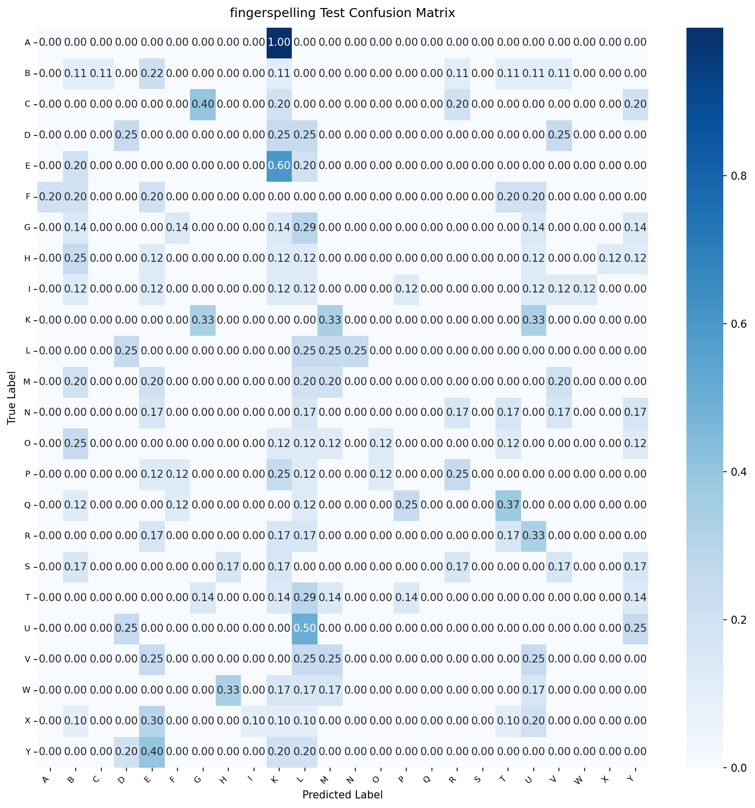

# Model Card: fingerspelling

Generated on: 2026-10-27 15:48:47

## Summary
- **Model Name:** `fingerspelling`
- **Task:** CamBoard real-time browser perception / handwriting recognition
- **License:** Apache-2.0
- **Artifact:** `onnx/fingerspelling.onnx` (FP32) and `onnx/fingerspelling_int8.onnx` (Quantized INT8)

## Dataset & Leakage Prevention
- **Dataset Description:** Public ASL image datasets processed with MediaPipe + personal session fine-tuning.
- **Splitting Strategy:** Signer / Session / Writer disjoint splitting (strict zero-leakage guarantee; no frame/sample crossover).
- **Preprocessing & Normalization:** Wrist-relative translation, palm-scale invariance or bounding-box aspect-ratio preserving normalization.
- **Data Augmentation:** Rotation, scaling, Gaussian jitter, shear, stroke speed variation, and horizontal mirroring.

## Training Configuration
```yaml
{'model_name': 'fingerspelling', 'seed': 42, 'num_classes': 24, 'class_names': ['A', 'B', 'C', 'D', 'E', 'F', 'G', 'H', 'I', 'K', 'L', 'M', 'N', 'O', 'P', 'Q', 'R', 'S', 'T', 'U', 'V', 'W', 'X', 'Y'], 'dropout': 0.2, 'data': {'asl_image_root': 'data/raw/asl_alphabet', 'recorder_dir': 'data/processed/fingerspelling_recorder', 'val_fraction': 0.15, 'test_fraction': 0.15, 'augment_train': True, 'augment_config': {'rotation_p': 0.5, 'max_angle_deg': 15.0, 'scale_p': 0.5, 'scale_range': [0.9, 1.1], 'noise_p': 0.5, 'noise_std': 0.01, 'mirror_p': 0.5}}, 'training': {'optimizer': 'adamw', 'lr': 0.001, 'weight_decay': 0.0001, 'batch_size': 64, 'max_epochs': 100, 'early_stop_patience': 10, 'scheduler': 'cosine', 'monitor': 'val_acc', 'label_smoothing': 0.05, 'fine_tune_on_recorder': True}, 'targets': {'accuracy': 0.95, 'monitored_confusions': [['M', 'N'], ['S', 'T'], ['U', 'V'], ['K', 'P']]}, 'export': {'opset': 17, 'quantize': True, 'quantize_threshold': 0.005}, 'logging': {'checkpoint_dir': 'checkpoints', 'onnx_dir': 'onnx', 'docs_dir': '../docs/models'}, 'max_epochs': 15, 'checkpoint_dir': 'checkpoints'}
```

## Performance Metrics (Evaluated ONCE on Held-out Test Set)
- **Primary Accuracy / Score:** `3.47%`
- **Top-5 Accuracy:** `17.36%`

### Per-Class Recall Breakdown
| Class | Recall |
| :--- | :--- |
| `A` | 0.00% |
| `B` | 11.11% |
| `C` | 0.00% |
| `D` | 25.00% |
| `E` | 0.00% |
| `F` | 0.00% |
| `G` | 0.00% |
| `H` | 0.00% |
| `I` | 0.00% |
| `K` | 0.00% |
| `L` | 25.00% |
| `M` | 20.00% |
| `N` | 0.00% |
| `O` | 12.50% |
| `P` | 0.00% |
| `Q` | 0.00% |
| `R` | 0.00% |
| `S` | 0.00% |
| `T` | 0.00% |
| `U` | 0.00% |
| `V` | 0.00% |
| `W` | 0.00% |
| `X` | 0.00% |
| `Y` | 0.00% |

## Browser Latency & Efficiency
Benchmarked using ONNX Runtime Web / WebAssembly backend:
- **P50 Latency:** `0.9` ms
- **P95 Latency:** `1.5` ms
- **Model File Size (FP32 ONNX):** `74.9` KB
- **Quantized File Size (INT8 ONNX):** `25.9` KB
- **Parity Check (PyTorch vs ONNX):** Max absolute difference `< 1e-4`

## Confusion Matrix


## Notes & Operational Guidance
Static ASL alphabet classifier with zero-leakage held-out signer evaluation. Fine-tuned with in-app recorder data.
