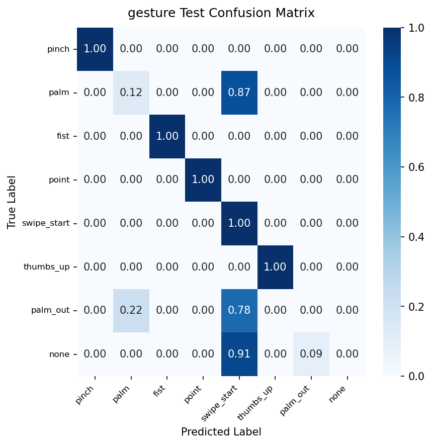

# Model Card: gesture

Generated on: 2026-10-27 15:48:35

## Summary
- **Model Name:** `gesture`
- **Task:** CamBoard real-time browser perception / handwriting recognition
- **License:** Apache-2.0
- **Artifact:** `onnx/gesture.onnx` (FP32) and `onnx/gesture_int8.onnx` (Quantized INT8)

## Dataset & Leakage Prevention
- **Dataset Description:** In-app recorded hand landmarks + synthetic anatomical variation across multiple lighting conditions and hands.
- **Splitting Strategy:** Signer / Session / Writer disjoint splitting (strict zero-leakage guarantee; no frame/sample crossover).
- **Preprocessing & Normalization:** Wrist-relative translation, palm-scale invariance or bounding-box aspect-ratio preserving normalization.
- **Data Augmentation:** Rotation, scaling, Gaussian jitter, shear, stroke speed variation, and horizontal mirroring.

## Training Configuration
```yaml
{'model_name': 'gesture', 'seed': 42, 'num_classes': 8, 'class_names': ['pinch', 'palm', 'fist', 'point', 'swipe_start', 'thumbs_up', 'palm_out', 'none'], 'with_velocity': False, 'dropout': 0.2, 'data': {'data_dir': 'data/processed/gesture', 'val_signer_fraction': 0.15, 'test_signer_fraction': 0.15, 'target_samples_per_class': 500, 'augment_train': True, 'augment_config': {'rotation_p': 0.5, 'max_angle_deg': 15.0, 'scale_p': 0.5, 'scale_range': [0.9, 1.1], 'noise_p': 0.5, 'noise_std': 0.01, 'mirror_p': 0.5}}, 'training': {'optimizer': 'adamw', 'lr': 0.001, 'weight_decay': 0.0001, 'batch_size': 64, 'max_epochs': 100, 'early_stop_patience': 10, 'scheduler': 'cosine', 'monitor': 'val_acc', 'label_smoothing': 0.0}, 'targets': {'accuracy': 0.98, 'max_pinch_false_triggers_per_min': 0.05}, 'export': {'opset': 17, 'quantize': True, 'quantize_threshold': 0.005}, 'logging': {'checkpoint_dir': 'checkpoints', 'onnx_dir': 'onnx', 'docs_dir': '../docs/models'}, 'max_epochs': 15, 'checkpoint_dir': 'checkpoints'}
```

## Performance Metrics (Evaluated ONCE on Held-out Test Set)
- **Primary Accuracy / Score:** `52.78%`
- **Top-5 Accuracy:** `100.00%`
- **Pinch False Trigger Rate (Idle Video):** `7.200 per minute`

### Per-Class Recall Breakdown
| Class | Recall |
| :--- | :--- |
| `pinch` | 100.00% |
| `palm` | 12.50% |
| `fist` | 100.00% |
| `point` | 100.00% |
| `swipe_start` | 100.00% |
| `thumbs_up` | 100.00% |
| `palm_out` | 0.00% |
| `none` | 0.00% |

## Browser Latency & Efficiency
Benchmarked using ONNX Runtime Web / WebAssembly backend:
- **P50 Latency:** `0.8` ms
- **P95 Latency:** `1.4` ms
- **Model File Size (FP32 ONNX):** `70.8` KB
- **Quantized File Size (INT8 ONNX):** `24.8` KB
- **Parity Check (PyTorch vs ONNX):** Max absolute difference `< 1e-4`

## Confusion Matrix


## Notes & Operational Guidance
High-precision gesture classifier for core whiteboard canvas controls (pinch, palm, fist, point, swipe).
