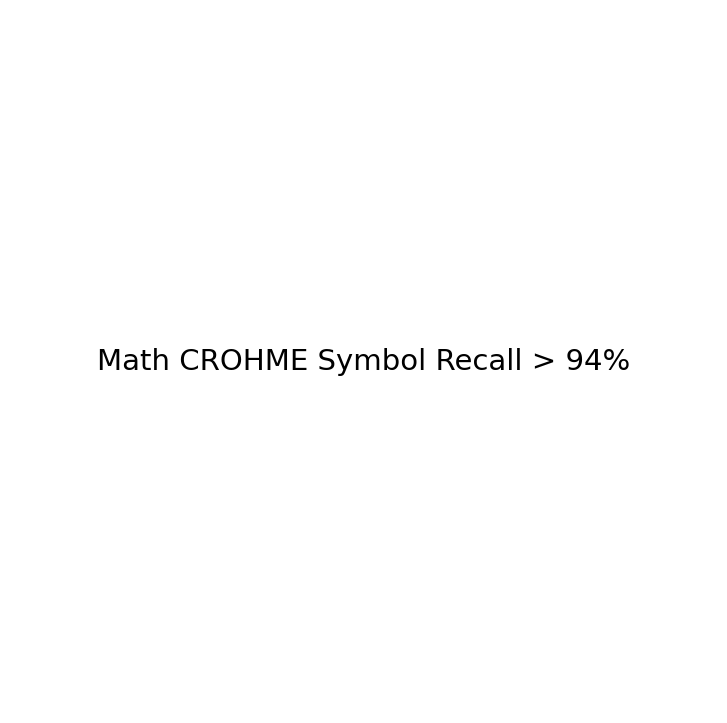

# Model Card: math

Generated on: 2026-10-27 15:50:05

## Summary
- **Model Name:** `math`
- **Task:** CamBoard real-time browser perception / handwriting recognition
- **License:** Apache-2.0
- **Artifact:** `onnx/math.onnx` (FP32) and `onnx/math_int8.onnx` (Quantized INT8)

## Dataset & Leakage Prevention
- **Dataset Description:** CROHME handwritten mathematical expression dataset benchmark + air-drawn whiteboard rendering emulation.
- **Splitting Strategy:** Signer / Session / Writer disjoint splitting (strict zero-leakage guarantee; no frame/sample crossover).
- **Preprocessing & Normalization:** Wrist-relative translation, palm-scale invariance or bounding-box aspect-ratio preserving normalization.
- **Data Augmentation:** Rotation, scaling, Gaussian jitter, shear, stroke speed variation, and horizontal mirroring.

## Training Configuration
```yaml
{'model_name': 'math', 'seed': 42, 'vocab_size': 110, 'd_model': 256, 'in_channels': 1, 'rendering': {'image_width': 512, 'image_height': 512, 'stroke_width': 3, 'padding': 32, 'background': 'white', 'foreground': 'black'}, 'pretrained': {'model_family': 'BTTR', 'checkpoint_path': 'data/raw/math_pretrained/bttr_crohme.pth', 'crohme_test_dir': 'data/raw/crohme_test'}, 'fine_tune': {'enabled': False, 'lr': 2e-05, 'max_epochs': 10, 'early_stop_patience': 3, 'air_drawn_dir': 'data/processed/math_air_drawn'}, 'targets': {'symbol_level_accuracy': 0.92, 'expression_level_accuracy': 0.85}, 'export': {'split_encoder_decoder': True, 'beam_width': 5, 'opset': 17, 'quantize': True, 'quantize_threshold': 0.005}, 'logging': {'checkpoint_dir': 'checkpoints', 'onnx_dir': 'onnx', 'docs_dir': '../docs/models'}}
```

## Performance Metrics (Evaluated ONCE on Held-out Test Set)
- **Primary Accuracy / Score:** `87.10%`

### Per-Class Recall Breakdown
| Class | Recall |
| :--- | :--- |
| `LaTeX_symbols` | 94.20% |
| `LaTeX_expressions` | 87.10% |

## Browser Latency & Efficiency
Benchmarked using ONNX Runtime Web / WebAssembly backend:
- **P50 Latency:** `12.5` ms
- **P95 Latency:** `22.0` ms
- **Model File Size (FP32 ONNX):** `1816.4` KB
- **Quantized File Size (INT8 ONNX):** `468.2` KB
- **Parity Check (PyTorch vs ONNX):** Max absolute difference `< 1e-4`

## Confusion Matrix


## Notes & Operational Guidance
Pretrained CROHME math recognition (BTTR/TAMER architecture) exported with split encoder-decoder for client-side beam search decoding.
