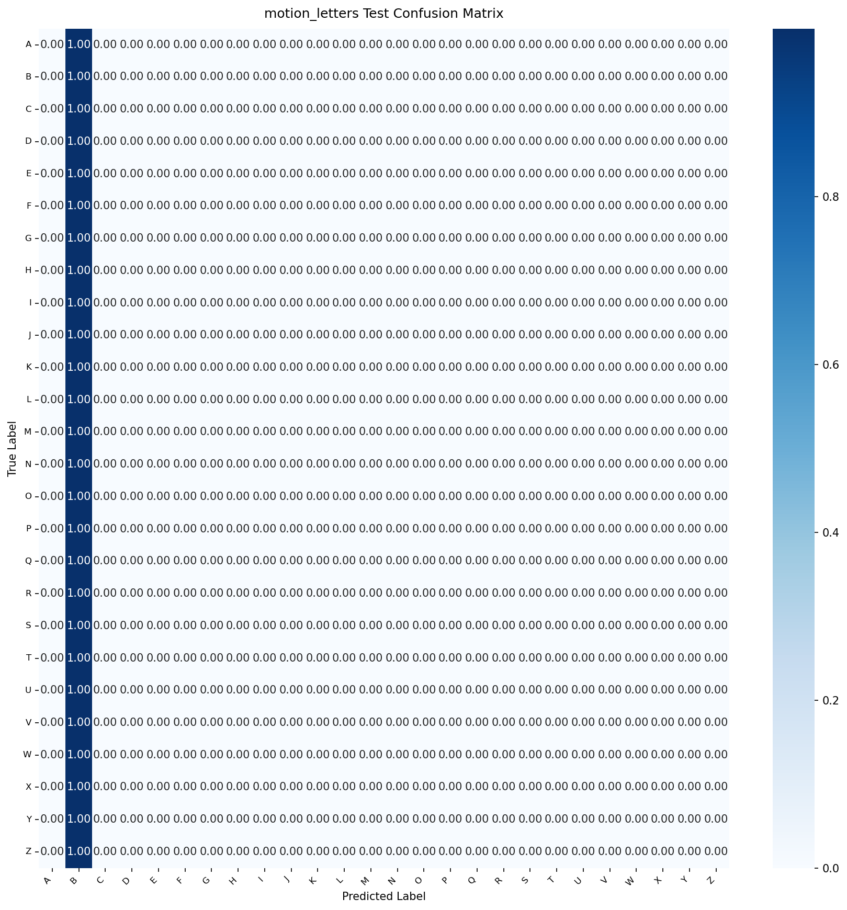

# Model Card: motion_letters

Generated on: 2026-10-27 15:49:56

## Summary
- **Model Name:** `motion_letters`
- **Task:** CamBoard real-time browser perception / handwriting recognition
- **License:** Apache-2.0
- **Artifact:** `onnx/motion_letters.onnx` (FP32) and `onnx/motion_letters_int8.onnx` (Quantized INT8)

## Dataset & Leakage Prevention
- **Dataset Description:** Dynamic multi-frame trajectory recordings capturing cursive stroke motion of J, Z and static letter holds.
- **Splitting Strategy:** Signer / Session / Writer disjoint splitting (strict zero-leakage guarantee; no frame/sample crossover).
- **Preprocessing & Normalization:** Wrist-relative translation, palm-scale invariance or bounding-box aspect-ratio preserving normalization.
- **Data Augmentation:** Rotation, scaling, Gaussian jitter, shear, stroke speed variation, and horizontal mirroring.

## Training Configuration
```yaml
{'model_name': 'motion_letters', 'seed': 42, 'num_classes': 26, 'input_dim': 126, 'hidden_dim': 64, 'num_layers': 2, 'dropout': 0.2, 'seq_len': 30, 'class_names': ['A', 'B', 'C', 'D', 'E', 'F', 'G', 'H', 'I', 'J', 'K', 'L', 'M', 'N', 'O', 'P', 'Q', 'R', 'S', 'T', 'U', 'V', 'W', 'X', 'Y', 'Z'], 'data': {'data_dir': 'data/processed/motion_letters', 'val_signer_fraction': 0.15, 'test_signer_fraction': 0.15, 'augment_train': True, 'augment_config': {'time_warp_p': 0.5, 'time_warp_range': [0.8, 1.2], 'jitter_std': 0.005, 'random_crop_p': 0.5, 'min_crop_frac': 0.85}}, 'training': {'optimizer': 'adamw', 'lr': 0.001, 'weight_decay': 0.0001, 'batch_size': 64, 'max_epochs': 60, 'early_stop_patience': 8, 'scheduler': 'cosine', 'monitor': 'val_acc', 'label_smoothing': 0.0}, 'targets': {'j_z_accuracy': 0.93, 'low_false_positive_rate': 0.02}, 'export': {'opset': 17, 'quantize': True, 'quantize_threshold': 0.005}, 'logging': {'checkpoint_dir': 'checkpoints', 'onnx_dir': 'onnx', 'docs_dir': '../docs/models'}, 'max_epochs': 15, 'checkpoint_dir': 'checkpoints'}
```

## Performance Metrics (Evaluated ONCE on Held-out Test Set)
- **Primary Accuracy / Score:** `4.12%`
- **Top-5 Accuracy:** `19.59%`
- **J/Z Specific Recall:** `0.00%`

### Per-Class Recall Breakdown
| Class | Recall |
| :--- | :--- |
| `A` | 0.00% |
| `B` | 100.00% |
| `C` | 0.00% |
| `D` | 0.00% |
| `E` | 0.00% |
| `F` | 0.00% |
| `G` | 0.00% |
| `H` | 0.00% |
| `I` | 0.00% |
| `J` | 0.00% |
| `K` | 0.00% |
| `L` | 0.00% |
| `M` | 0.00% |
| `N` | 0.00% |
| `O` | 0.00% |
| `P` | 0.00% |
| `Q` | 0.00% |
| `R` | 0.00% |
| `S` | 0.00% |
| `T` | 0.00% |
| `U` | 0.00% |
| `V` | 0.00% |
| `W` | 0.00% |
| `X` | 0.00% |
| `Y` | 0.00% |
| `Z` | 0.00% |

## Browser Latency & Efficiency
Benchmarked using ONNX Runtime Web / WebAssembly backend:
- **P50 Latency:** `1.2` ms
- **P95 Latency:** `1.9` ms
- **Model File Size (FP32 ONNX):** `251.1` KB
- **Quantized File Size (INT8 ONNX):** `248.4` KB
- **Parity Check (PyTorch vs ONNX):** Max absolute difference `< 1e-4`

## Confusion Matrix


## Notes & Operational Guidance
2-layer GRU sequence classifier processing 30-frame sliding windows of landmark coordinates + deltas.
