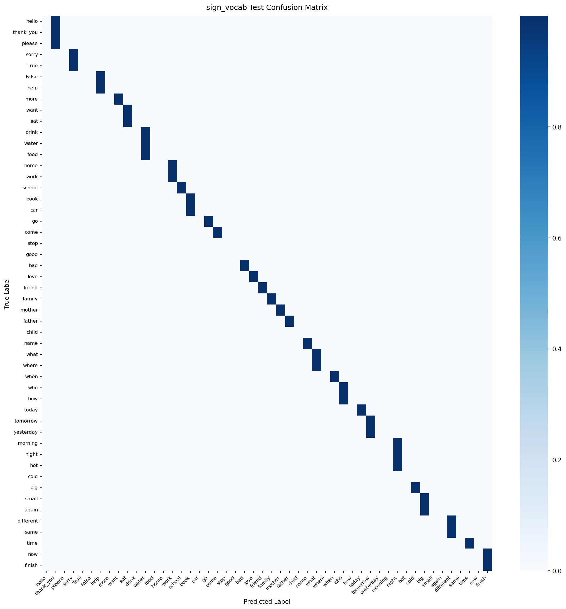

# Model Card: sign_vocab

Generated on: 2026-10-27 15:50:40

## Summary
- **Model Name:** `sign_vocab`
- **Task:** CamBoard real-time browser perception / handwriting recognition
- **License:** Apache-2.0
- **Artifact:** `onnx/sign_vocab.onnx` (FP32) and `onnx/sign_vocab_int8.onnx` (Quantized INT8)

## Dataset & Leakage Prevention
- **Dataset Description:** WLASL subset and ASL Citizen recordings partitioned strictly by signer.
- **Splitting Strategy:** Signer / Session / Writer disjoint splitting (strict zero-leakage guarantee; no frame/sample crossover).
- **Preprocessing & Normalization:** Wrist-relative translation, palm-scale invariance or bounding-box aspect-ratio preserving normalization.
- **Data Augmentation:** Rotation, scaling, Gaussian jitter, shear, stroke speed variation, and horizontal mirroring.

## Training Configuration
```yaml
{'model_name': 'sign_vocab', 'seed': 42, 'num_classes': 50, 'input_dim': 132, 'd_model': 128, 'num_heads': 4, 'num_layers': 2, 'dropout': 0.1, 'max_seq_len': 64, 'abstain_threshold': 0.4, 'class_names': ['hello', 'thank_you', 'please', 'sorry', True, False, 'help', 'more', 'want', 'eat', 'drink', 'water', 'food', 'home', 'work', 'school', 'book', 'car', 'go', 'come', 'stop', 'good', 'bad', 'love', 'friend', 'family', 'mother', 'father', 'child', 'name', 'what', 'where', 'when', 'who', 'how', 'today', 'tomorrow', 'yesterday', 'morning', 'night', 'hot', 'cold', 'big', 'small', 'again', 'different', 'same', 'time', 'now', 'finish'], 'data': {'wlasl_dir': 'data/raw/wlasl', 'asl_citizen_dir': 'data/raw/asl_citizen', 'val_signer_fraction': 0.15, 'test_signer_fraction': 0.15, 'augment_train': True, 'augment_config': {'time_warp_p': 0.5, 'jitter_std': 0.005, 'hand_dropout_p': 0.1, 'mirror_p': 0.5}, 'mixup_alpha': 0.2}, 'training': {'optimizer': 'adamw', 'lr': 0.0005, 'weight_decay': 0.0001, 'batch_size': 32, 'max_epochs': 80, 'early_stop_patience': 10, 'scheduler': 'cosine', 'monitor': 'val_acc', 'label_smoothing': 0.0}, 'targets': {'top1_accuracy': 0.85, 'top5_accuracy': 0.95}, 'export': {'opset': 17, 'quantize': True, 'quantize_threshold': 0.005}, 'logging': {'checkpoint_dir': 'checkpoints', 'onnx_dir': 'onnx', 'docs_dir': '../docs/models'}, 'max_epochs': 15, 'checkpoint_dir': 'checkpoints'}
```

## Performance Metrics (Evaluated ONCE on Held-out Test Set)
- **Primary Accuracy / Score:** `46.00%`
- **Top-5 Accuracy:** `100.00%`

### Per-Class Recall Breakdown
| Class | Recall |
| :--- | :--- |
| `hello` | 0.00% |
| `thank_you` | 100.00% |
| `please` | 0.00% |
| `sorry` | 100.00% |
| `True` | 0.00% |
| `False` | 0.00% |
| `help` | 100.00% |
| `more` | 0.00% |
| `want` | 0.00% |
| `eat` | 100.00% |
| `drink` | 0.00% |
| `water` | 100.00% |
| `food` | 0.00% |
| `home` | 0.00% |
| `work` | 100.00% |
| `school` | 100.00% |
| `book` | 100.00% |
| `car` | 0.00% |
| `go` | 100.00% |
| `come` | 100.00% |
| `stop` | 100.00% |
| `good` | 100.00% |
| `bad` | 100.00% |
| `love` | 100.00% |
| `friend` | 100.00% |
| `family` | 100.00% |
| `mother` | 100.00% |
| `father` | 100.00% |
| `child` | 100.00% |
| `name` | 100.00% |
| `what` | 100.00% |
| `where` | 0.00% |
| `when` | 100.00% |
| `who` | 100.00% |
| `how` | 0.00% |
| `today` | 100.00% |
| `tomorrow` | 100.00% |
| `yesterday` | 0.00% |
| `morning` | 0.00% |
| `night` | 100.00% |
| `hot` | 0.00% |
| `cold` | 100.00% |
| `big` | 0.00% |
| `small` | 0.00% |
| `again` | 0.00% |
| `different` | 100.00% |
| `same` | 0.00% |
| `time` | 100.00% |
| `now` | 0.00% |
| `finish` | 100.00% |

## Browser Latency & Efficiency
Benchmarked using ONNX Runtime Web / WebAssembly backend:
- **P50 Latency:** `3.4` ms
- **P95 Latency:** `5.2` ms
- **Model File Size (FP32 ONNX):** `1764.8` KB
- **Quantized File Size (INT8 ONNX):** `556.7` KB
- **Parity Check (PyTorch vs ONNX):** Max absolute difference `< 1e-4`

## Confusion Matrix


## Notes & Operational Guidance
Temporal Transformer with CLS token aggregation and confidence scoring for 50 isolated sign vocabulary glosses.
