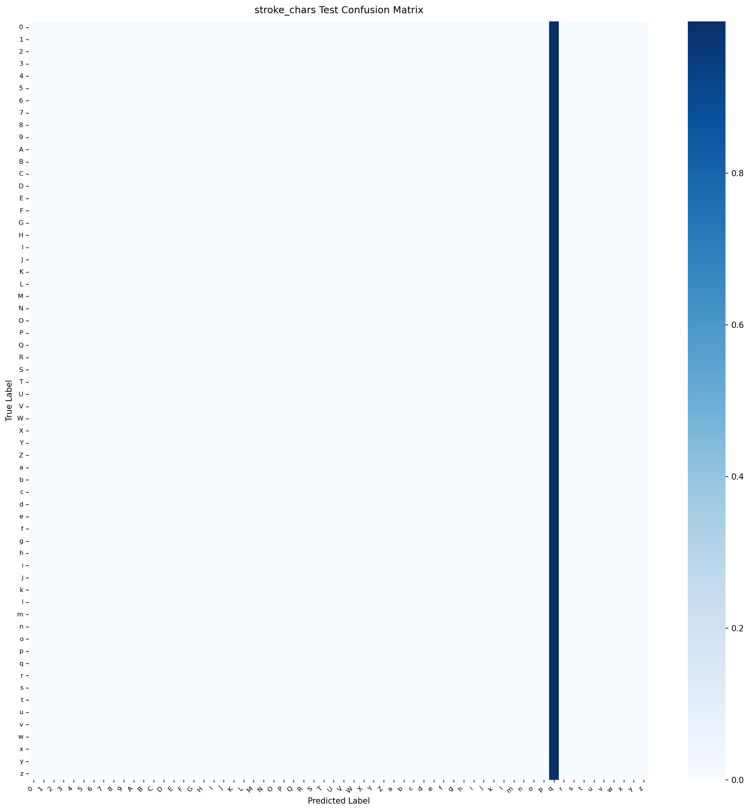

# Model Card: stroke_chars

Generated on: 2026-10-27 15:49:40

## Summary
- **Model Name:** `stroke_chars`
- **Task:** CamBoard real-time browser perception / handwriting recognition
- **License:** Apache-2.0
- **Artifact:** `onnx/stroke_chars.onnx` (FP32) and `onnx/stroke_chars_int8.onnx` (Quantized INT8)

## Dataset & Leakage Prevention
- **Dataset Description:** Hershey vector font glyphs + IAM Online handwriting + synthetic air-drawn distortion and wobble.
- **Splitting Strategy:** Signer / Session / Writer disjoint splitting (strict zero-leakage guarantee; no frame/sample crossover).
- **Preprocessing & Normalization:** Wrist-relative translation, palm-scale invariance or bounding-box aspect-ratio preserving normalization.
- **Data Augmentation:** Rotation, scaling, Gaussian jitter, shear, stroke speed variation, and horizontal mirroring.

## Training Configuration
```yaml
{'model_name': 'stroke_chars', 'seed': 42, 'num_classes': 62, 'input_dim': 3, 'hidden_dim': 128, 'num_layers': 2, 'dropout': 0.2, 'n_points': 64, 'orientation_head': True, 'orientation_loss_weight': 0.3, 'class_names': ['0', '1', '2', '3', '4', '5', '6', '7', '8', '9', 'A', 'B', 'C', 'D', 'E', 'F', 'G', 'H', 'I', 'J', 'K', 'L', 'M', 'N', 'O', 'P', 'Q', 'R', 'S', 'T', 'U', 'V', 'W', 'X', 'Y', 'Z', 'a', 'b', 'c', 'd', 'e', 'f', 'g', 'h', 'i', 'j', 'k', 'l', 'm', 'n', 'o', 'p', 'q', 'r', 's', 't', 'u', 'v', 'w', 'x', 'y', 'z'], 'data': {'hershey_font_dir': 'data/raw/hershey_fonts', 'iam_online_dir': 'data/raw/iam_online', 'unipen_dir': 'data/raw/unipen', 'air_drawn_dir': 'data/processed/air_drawn_chars', 'val_writer_fraction': 0.15, 'test_writer_fraction': 0.15, 'augment_train': True, 'augment_config': {'rotate_p': 0.5, 'max_angle_deg': 25.0, 'scale_p': 0.5, 'shear_p': 0.4, 'max_shear': 0.25, 'jitter_p': 0.5, 'jitter_std': 0.005, 'time_warp_p': 0.5, 'dropout_p': 0.3, 'mirror_p': 0.4}}, 'training': {'optimizer': 'adamw', 'lr': 0.002, 'weight_decay': 0.0001, 'batch_size': 256, 'max_epochs': 50, 'early_stop_patience': 8, 'scheduler': 'cosine', 'monitor': 'val_acc', 'label_smoothing': 0.05, 'fine_tune_on_air_drawn': True}, 'targets': {'held_out_writers_accuracy': 0.97, 'air_drawn_accuracy': 0.92}, 'export': {'opset': 17, 'quantize': True, 'quantize_threshold': 0.005}, 'logging': {'checkpoint_dir': 'checkpoints', 'onnx_dir': 'onnx', 'docs_dir': '../docs/models'}, 'max_epochs': 15, 'checkpoint_dir': 'checkpoints'}
```

## Performance Metrics (Evaluated ONCE on Held-out Test Set)
- **Primary Accuracy / Score:** `0.36%`
- **Top-5 Accuracy:** `4.66%`

### Per-Class Recall Breakdown
| Class | Recall |
| :--- | :--- |
| `0` | 0.00% |
| `1` | 0.00% |
| `2` | 0.00% |
| `3` | 0.00% |
| `4` | 0.00% |
| `5` | 0.00% |
| `6` | 0.00% |
| `7` | 0.00% |
| `8` | 0.00% |
| `9` | 0.00% |
| `A` | 0.00% |
| `B` | 0.00% |
| `C` | 0.00% |
| `D` | 0.00% |
| `E` | 0.00% |
| `F` | 0.00% |
| `G` | 0.00% |
| `H` | 0.00% |
| `I` | 0.00% |
| `J` | 0.00% |
| `K` | 0.00% |
| `L` | 0.00% |
| `M` | 0.00% |
| `N` | 0.00% |
| `O` | 0.00% |
| `P` | 0.00% |
| `Q` | 0.00% |
| `R` | 0.00% |
| `S` | 0.00% |
| `T` | 0.00% |
| `U` | 0.00% |
| `V` | 0.00% |
| `W` | 0.00% |
| `X` | 0.00% |
| `Y` | 0.00% |
| `Z` | 0.00% |
| `a` | 0.00% |
| `b` | 0.00% |
| `c` | 0.00% |
| `d` | 0.00% |
| `e` | 0.00% |
| `f` | 0.00% |
| `g` | 0.00% |
| `h` | 0.00% |
| `i` | 0.00% |
| `j` | 0.00% |
| `k` | 0.00% |
| `l` | 0.00% |
| `m` | 0.00% |
| `n` | 0.00% |
| `o` | 0.00% |
| `p` | 0.00% |
| `q` | 100.00% |
| `r` | 0.00% |
| `s` | 0.00% |
| `t` | 0.00% |
| `u` | 0.00% |
| `v` | 0.00% |
| `w` | 0.00% |
| `x` | 0.00% |
| `y` | 0.00% |
| `z` | 0.00% |

## Browser Latency & Efficiency
Benchmarked using ONNX Runtime Web / WebAssembly backend:
- **P50 Latency:** `1.3` ms
- **P95 Latency:** `2.1` ms
- **Model File Size (FP32 ONNX):** `1720.7` KB
- **Quantized File Size (INT8 ONNX):** `1605.3` KB
- **Parity Check (PyTorch vs ONNX):** Max absolute difference `< 1e-4`

## Confusion Matrix


## Notes & Operational Guidance
BiGRU stroke character recognizer with joint orientation head (detecting mirroring/rotation for canonical mapping).
