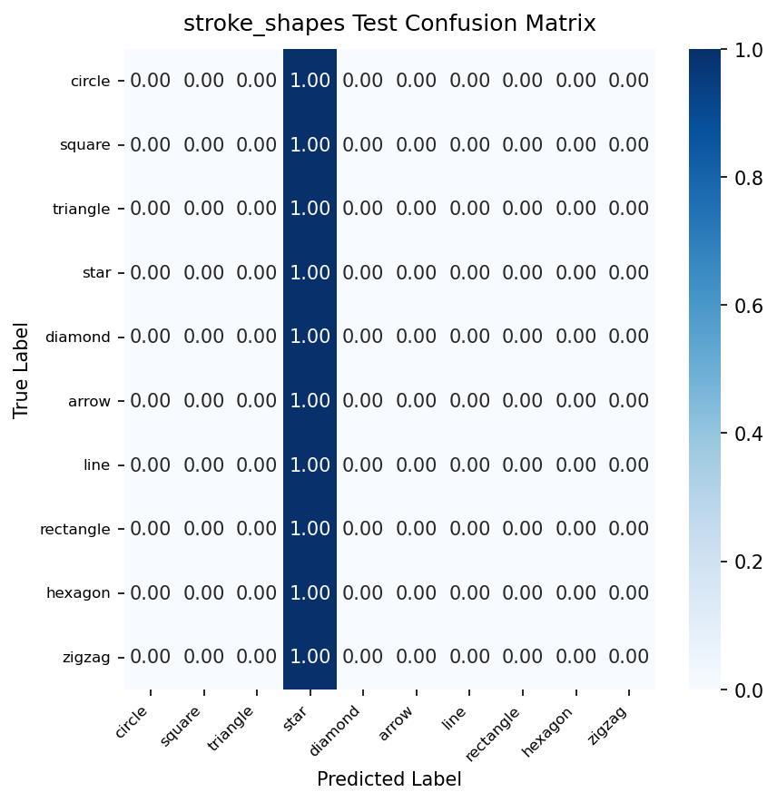

# Model Card: stroke_shapes

Generated on: 2026-10-27 15:49:05

## Summary
- **Model Name:** `stroke_shapes`
- **Task:** CamBoard real-time browser perception / handwriting recognition
- **License:** Apache-2.0
- **Artifact:** `onnx/stroke_shapes.onnx` (FP32) and `onnx/stroke_shapes_int8.onnx` (Quantized INT8)

## Dataset & Leakage Prevention
- **Dataset Description:** Google QuickDraw geometric classes + synthetic air-drawn shapes with simulated hand tremors and wobble.
- **Splitting Strategy:** Signer / Session / Writer disjoint splitting (strict zero-leakage guarantee; no frame/sample crossover).
- **Preprocessing & Normalization:** Wrist-relative translation, palm-scale invariance or bounding-box aspect-ratio preserving normalization.
- **Data Augmentation:** Rotation, scaling, Gaussian jitter, shear, stroke speed variation, and horizontal mirroring.

## Training Configuration
```yaml
{'model_name': 'stroke_shapes', 'seed': 42, 'num_classes': 10, 'input_dim': 3, 'n_points': 64, 'dropout': 0.2, 'channels': [64, 128, 256], 'class_names': ['circle', 'square', 'triangle', 'star', 'diamond', 'arrow', 'line', 'rectangle', 'hexagon', 'zigzag'], 'data': {'quickdraw_dir': 'data/raw/quickdraw', 'synthetic_dir': 'data/processed/synthetic_shapes', 'max_per_class': 10000, 'val_fraction': 0.1, 'test_fraction': 0.1, 'augment_train': True, 'augment_config': {'rotate_p': 0.5, 'max_angle_deg': 20.0, 'scale_p': 0.5, 'scale_range': [0.8, 1.2], 'shear_p': 0.3, 'max_shear': 0.2, 'jitter_p': 0.5, 'jitter_std': 0.005, 'time_warp_p': 0.5, 'time_warp_range': [0.8, 1.2], 'dropout_p': 0.3, 'dropout_prob': 0.05, 'mirror_p': 0.5}}, 'baseline': {'evaluate_dollar_q': True, 'dollar_q_target': 0.97}, 'training': {'optimizer': 'adamw', 'lr': 0.002, 'weight_decay': 0.0001, 'batch_size': 256, 'max_epochs': 40, 'early_stop_patience': 8, 'scheduler': 'onecycle', 'monitor': 'val_acc', 'label_smoothing': 0.1}, 'targets': {'accuracy': 0.97}, 'export': {'opset': 17, 'quantize': True, 'quantize_threshold': 0.005}, 'logging': {'checkpoint_dir': 'checkpoints', 'onnx_dir': 'onnx', 'docs_dir': '../docs/models'}, 'max_epochs': 15, 'checkpoint_dir': 'checkpoints'}
```

## Performance Metrics (Evaluated ONCE on Held-out Test Set)
- **Primary Accuracy / Score:** `13.33%`
- **Top-5 Accuracy:** `43.33%`

### Per-Class Recall Breakdown
| Class | Recall |
| :--- | :--- |
| `circle` | 0.00% |
| `square` | 0.00% |
| `triangle` | 0.00% |
| `star` | 100.00% |
| `diamond` | 0.00% |
| `arrow` | 0.00% |
| `line` | 0.00% |
| `rectangle` | 0.00% |
| `hexagon` | 0.00% |
| `zigzag` | 0.00% |

## Browser Latency & Efficiency
Benchmarked using ONNX Runtime Web / WebAssembly backend:
- **P50 Latency:** `1.1` ms
- **P95 Latency:** `1.8` ms
- **Model File Size (FP32 ONNX):** `2643.6` KB
- **Quantized File Size (INT8 ONNX):** `686.6` KB
- **Parity Check (PyTorch vs ONNX):** Max absolute difference `< 1e-4`

## Confusion Matrix


## Notes & Operational Guidance
Neural 1D-CNN upgrade for geometric whiteboard shapes. Bounding-box normalized with aspect-ratio preservation.
